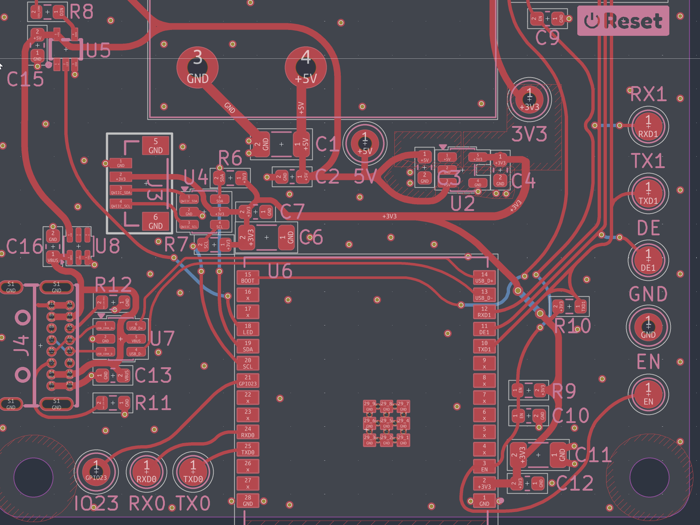

# Round Tracks (Adaptive)
A KiCad plugin that rounds track corners with native arcs, sized to fit the room around each corner.



Arcs shrink to keep clearance to vias, pads, holes, the board edge and keepouts. Close bends merge into one arc, and router fragments are cleaned up first. Corners that can't be rounded are marked on the User.Comments layer. Requires KiCad 10 or later.

This is a fork of [mitxela/kicad-round-tracks](https://github.com/mitxela/kicad-round-tracks) with a new rounding engine; see History.

## Installation
Install it from this repository's package feed in KiCad's Plugin and Content Manager:

1. Open the Plugin and Content Manager and choose **Manage...** next to the repository list.
2. Add this repository URL:
   ```
   https://raw.githubusercontent.com/jrowe88/kicad-round-tracks/master/pcm/repository.json
   ```
3. Select the new repository, find **Round Tracks (Adaptive)** and install it.

If mitxela's original Round Tracks is installed, uninstall it first: both register a "Round tracks" action.

For a manual install, clone or unzip this repository into a KiCad plugin folder. To list the folders KiCad searches, open the scripting console in the PCB editor and run:
```
import pcbnew
print(pcbnew.GetWizardsSearchPaths())
```

Under Preferences / PCB Editor / Action Plugins you can choose whether the plugin gets a toolbar button.

## Use
Run **Round tracks** from the toolbar or Tools / External Plugins. In the dialog, tick **Round** for each net class to process and set its **Target Radius (mm)**, then press **Run**. Always run DRC afterwards.

- **Selected tracks only**: shows how many tracks are selected. If any are, it is ticked and only those tracks are rounded; untick it to process the whole board.
- **Create a new file**: appends "-rounded" to the board's file name, so the next Save doesn't overwrite your source board. Nothing is written until you save.
- **Ignore junctions**: leaves every point where three or more tracks meet alone.
- **Refill zones**: refills all zones after the run. Off by default; the choice is remembered per board.
- **Min radius (mm)**: corners that can only fit a smaller arc are left sharp.

Each run is a single undo step, so Ctrl+Z puts everything back exactly. Settings are saved per board in `<board>.round-tracks-config`.

### Radius
Target Radius is the true arc radius on a 90° bend. Shallower bends get a larger arc for the same setting so they look as gentle: a 45° bend gets about 2.7× the radius. A smaller arc is used when the tracks are too short or something is in the way. A radius of 0 turns rounding off for that net class.

Corners on a pad, a via or an existing arc are skipped, so track ends there never move. Where other copper of the same net joins a track partway along (another track's end, a via or a pad), the arc stops short of it so the joint stays on copper.

When two corners share a segment too short for both, the segment is split between them in proportion to what each needs. Two or more bends that turn the same way and are joined by short segments (two 45° bends close together, say) become one larger arc if it fits. Bends that turn opposite ways (an S-jog) are never merged.

Before rounding, collinear fragments and tiny slivers are merged away, and router-left micro-jogs (a kink no longer than half the track width) are straightened where the moved copper still clears everything around it. Joints that turn by less than about 1° are left alone. Every arc is tangent to the tracks on both sides; where that isn't possible, the corner stays sharp.

### Junctions
Where three or more tracks meet, each pair of neighbouring tracks gets an arc and every track is shortened by the same amount. A junction is all or nothing: if any of its arcs can't fit, the whole junction stays sharp.

### Clearance
Each new arc is checked against other nets' tracks, arcs, vias and pads (through-hole pads on every copper layer), drilled holes, the board edge, and keepouts that forbid tracks, using the net class and board clearances. If an arc doesn't clear, smaller arcs are tried and the largest that clears is used; if none does, the corner stays sharp. Like KiCad's DRC, the check allows a little slack (0.25 µm), so tracks routed at exactly minimum spacing can still be rounded. Custom rules in a `.kicad_dru` file and copper text are not modelled, and zone fills are ignored.

### Warnings
Every corner left sharp because it was too short or blocked gets an arrow and a label ("too short" or "clearance") on the User.Comments layer. Corners skipped on purpose, such as where the track width changes, get no arrow. All arrows are in one group named `round-tracks-warnings`, so you can select and delete them in one click; each run replaces the previous run's group. When a run finishes, the plugin reports how many corners were rounded at full radius, reduced, merged, left sharp and skipped.

### Unround
**Unround** turns arcs back into corners where their tangents meet. It is approximate: a merged arc comes back as a single corner, and cleaned-up fragments don't come back. Arcs that turn nearly 180° are left in place. Use Ctrl+Z straight after a run for an exact undo.

## Development
The tests use KiCad's bundled Python and need `kicad-cli` (installed with KiCad) for the DRC checks. From the repository root on Windows:
```
"C:\Program Files\KiCad\10.0\bin\python.exe" -m unittest discover -s tests -t . -v
```
A full run takes several minutes. `tests/test_geom.py` covers the geometry; `tests/test_cases.py` builds a small board for each case, rounds it headless and runs DRC on the result.

To build a release, run `python tools/build_pcm.py <version>`. It writes the package zip to `dist/` (attach it to the GitHub release tagged `v<version>`) and refreshes the files in `pcm/` (commit them to master).

## History
Based on [kicad-round-tracks](https://github.com/mitxela/kicad-round-tracks) by mitxela ([write-up](https://mitxela.com/projects/melting_kicad)), which grew from [flexRoundingSuite](https://github.com/jcloiacon/flexRoundingSuite) by Julian Loiacono and [kicad-round-tracks](https://github.com/stimulu/kicad-round-tracks) by Antoine Pintout. This fork replaces the subdivision engine with clearance-aware native arcs.

Original copyright Miles McCoo, 2017  
Extensively modified by Julian Loiacono, Oct 2018  
Multi-layer support and repacked as action plugin by Antoine Pintout, May 2019  
Updated subdivision algorithm by mitxela, Jan 2021  
Adaptive native fillets, clearance checks and warnings by Jim Rowe, Oct 2026  

Licensed under the Apache License 2.0.
